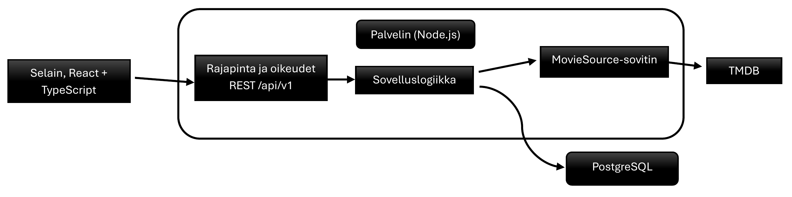
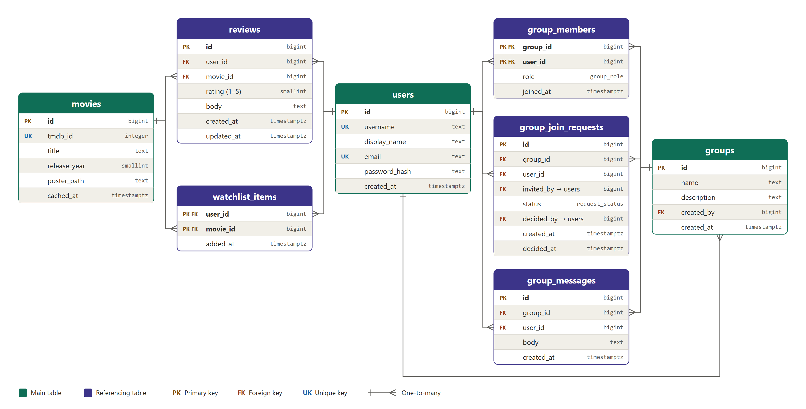

# Tekninen määrittely – Elokuvaharrastajien yhteisöpalvelu

Versio 1.0 · 11.11.2026

## 1. Johdanto

Tämä dokumentti kuvaa, miten elokuvaharrastajien yhteisöpalvelu toteutetaan. Pohjana ovat vaatimusmäärittely (versio 1.0, 28.10.2026) ja ER-kaavio. Teknologiavalinnat ovat alustavia ehdotuksia, jotka tiimi vahvistaa.

**Rajoitteet vaatimusmäärittelystä:** TMDB:n käyttöehtojen noudattaminen ja lähteen maininta (NFR-11), toiminta puhelimella ja tietokoneella (NFR-01), suomenkielinen käyttöliittymä niin, että ruotsi ja englanti voidaan lisätä myöhemmin (NFR-12) sekä GDPR (NFR-08).

**Mitoitus:** muutama tuhat aktiivista käyttäjää.

**Ajoalusta:** palvelu ajetaan Microsoft Azuressa, mikä vaikuttaa ajoalustan, tietokannan sekä avainten ja salasanojen hallinnan valintoihin (luvut 3 ja 7).

## 2. Arkkitehtuuri

Sovellus koostuu selaimessa toimivasta käyttöliittymästä, palvelimesta ja tietokannasta. Elokuvatiedot haetaan palvelimelta TMDB:stä.

Selain ei ole yhteydessä suoraan tietokantaan eikä TMDB:hen. Näin käyttöoikeudet tarkistetaan aina palvelimella (NFR-06), API-avain pysyy salassa ja elokuvatietolähteen voi tarvittaessa vaihtaa yhdessä paikassa (NFR-10).

## 3. Teknologiat

| Osa-alue | Valinta | Perustelu |
| --- | --- | --- |
| Käyttöliittymä | React + TypeScript | Yleinen ja soveltuu hyvin mobiili- ja työpöytäkäyttöön |
| Käännökset | react-i18next | Suomi ensin, muut kielet lisättävissä myöhemmin |
| Palvelin | Node.js + TypeScript | Sama kieli kuin käyttöliittymässä |
| Ajoalusta | Azure App Service tai Azure Container Apps (Docker-kuva) | Azure on käytössä, ja Docker-kuva toimii molemmissa |
| Käyttöliittymän jakelu | Azure Static Web Apps tai sama palvelu kuin palvelin | Käyttöliittymä on staattisia tiedostoja |
| Tietokanta | PostgreSQL (Azure Database for PostgreSQL) | Käyttäjien, ryhmien ja arvostelujen suhteet sopivat relaatiotietokantaan; hallittu palvelu vähentää ylläpitoa |
| Avaimet ja salasanat | Azure Key Vault | TMDB-avain ja istuntoavain pysyvät pois koodista |
| Elokuvatiedot | TMDB palvelimen kautta | Pakollinen tietolähde (FR-05); API-avain ei päädy selaimeen |
| Salasanat | argon2 tai bcrypt | Tallennus hajautettuna (NFR-05) |
| Testaus | Vitest, Supertest, Playwright | Yksikkö-, rajapinta- ja selaintestit |
| Julkaisu | Docker + GitHub Actions (tai Azure DevOps) | Yhtenäinen ympäristö sekä automaattiset testit ja julkaisu |

Chat toteutetaan ensimmäisessä versiossa ilman reaaliaikaisuutta. Reaaliaikaisuus (esim. WebSocket) voidaan lisätä myöhemmin.

## 4. Tietomalli

Tietokantakaaviossa on kahdeksan taulua, ja ne riittävät ensimmäiseen versioon.

| Taulu | Käyttötarkoitus |
| --- | --- |
| `users` | Käyttäjät; muille näkyy vain `display_name`, ei sähköpostia (FR-10) |
| `movies` | TMDB-elokuvien perustiedot ja välimuisti |
| `reviews` | Arvosana 1–5 ja teksti |
| `watchlist_items` | Katselulista |
| `groups` | Ryhmät; perustajasta tulee admin |
| `group_members` | Jäsenet ja rooli |
| `group_join_requests` | Liittymispyynnöt ja kutsut |
| `group_messages` | Ryhmän chat |

Kaaviosta puuttuu vielä seuraavat, jotka tarvitaan, kun vastaavat ominaisuudet otetaan työn alle:

- **Arvostelun näkyvyys** (julkinen tai vain ryhmälle, FR-17): `reviews`-tauluun näkyvyyskenttä ja `group_id`.
- **Omat listat ja jakolinkit** (FR-19, FR-20): uudet taulut `lists` ja `list_items`.
- **Ryhmäkutsut linkillä** (FR-29): taulu kutsutunnisteille.
- **Tilin poisto** (GDPR): päätettävä, poistetaanko vai anonymisoidaanko käyttäjän arvostelut.

## 5. Rajapinnat

Sovelluksella on oma REST-rajapinta polussa `/api/v1`. Tarkat polut määritellään toteutuksen aikana.

| Resurssi | Toiminnot | Käyttöoikeus |
| --- | --- | --- |
| Elokuvat | haku, selaus, yksittäinen elokuva | Kaikki |
| Tunnistautuminen | rekisteröityminen, kirjautuminen, uloskirjautuminen | Kaikki |
| Arvostelut | luku ja kirjoitus | Luku kaikille (julkiset), kirjoitus kirjautuneille |
| Katselulista | lisäys ja poisto | Kirjautunut käyttäjä |
| Ryhmät | perustaminen, selaus, liittymispyyntö, hyväksyntä ja hylkäys | Kirjautunut; päätökset ryhmän adminille |
| Chat | viestien luku ja lähetys | Vain ryhmän jäsenet |

TMDB:tä kutsutaan vain palvelimelta. Haetut elokuvat tallennetaan `movies`-tauluun kutsujen vähentämiseksi. Jos TMDB ei vastaa, näytetään tallennetut tiedot ja virheilmoitus.

## 6. Tietoturva ja laatu

- **Tunnistautuminen:** istuntoeväste (`HttpOnly`, `Secure`), hajautetut salasanat ja HTTPS-yhteys (NFR-05).
- **Käyttöoikeudet:** palvelin tarkistaa käyttäjän oikeudet jokaisessa kutsussa. Ryhmän chat ja ryhmäarvostelut eivät avaudu ulkopuoliselle edes suoralla linkillä, ja tämä testataan automaattisesti (NFR-06).
- **Validointi:** syötteet validoidaan palvelimella; arvosana rajataan välille 1–5 myös tietokannassa. Salasanalle asetetaan vähimmäisvaatimukset (NFR-07).
- **Virheenkäsittely:** yhtenäinen virheviesti; lokiin ei tallenneta salasanoja eikä muita henkilötietoja.
- **Suorituskyky:** TMDB-tietojen välimuisti, listausten sivutus ja julisteiden latautuminen vasta näkyviin tullessa (NFR-09).
- **GDPR:** kerätään vain tarpeelliset tiedot, ja käyttäjä voi poistaa tilinsä (NFR-08).
- **Saavutettavuus:** riittävä kontrasti ja näppäimistökäyttö (NFR-04).

## 7. Kehitys ja käyttöönotto

- Kehitysympäristö käynnistetään Dockerilla (sovellus ja PostgreSQL).
- Tuotanto ajetaan Azuressa: sovellus Docker-kuvana App Servicessä tai Container Appsissa ja tietokanta Azure Database for PostgreSQL -palvelussa.
- Avaimet ja salasanat, kuten TMDB-avain, säilytetään Azure Key Vaultissa ja annetaan sovellukselle ympäristömuuttujina. Niitä ei tallenneta koodiin.
- Ympäristöt: kehitys, testaus ja tuotanto. Testauksella ja tuotannolla on Azuressa omat resurssit.
- Jokaisesta muutoksesta ajetaan testit ja tarkistukset (GitHub Actions tai Azure DevOps), ja päähaaraan yhdistäminen vaatii onnistuneen ajon. Julkaisu Azureen tehdään onnistuneen ajon jälkeen.
- Tietokannan muutokset tehdään migraatioilla, jotka ovat versionhallinnassa.
- Tuotannossa otetaan käyttöön tietokannan automaattiset varmuuskopiot.
- Tekniset tehtävät kirjataan Product Backlogiin, ja tämän dokumentin ajantasaisuus kuuluu Definition of Doneen.
